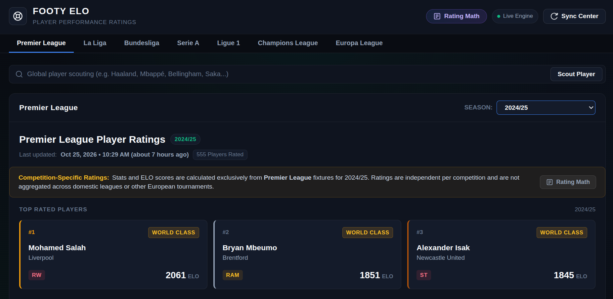
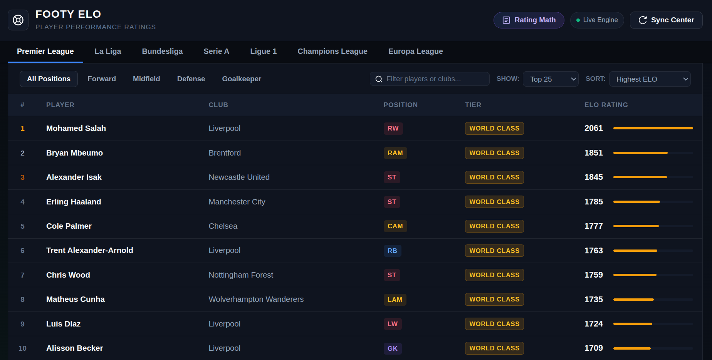

#  FOOTY ELO

A position-weighted football player rating engine and analytics dashboard.

**Live Web Application:** [https://footy-elo.vercel.app/](https://footy-elo.vercel.app/)

---

## Overview

Traditional football player rating systems exhibit heavy bias toward attacking metrics, disproportionately rewarding goals and assists over defensive discipline and midfield control.

**Footy ELO** introduces a position-weighted rating engine that evaluates player performance within specific tactical roles, calibrates ratings against a 1500 baseline across Europe's top competitions, and incorporates team success through competition-specific standings bonuses.

> **Inspiration & Citation**
> This project draws methodological inspiration from [beyondELO](https://beyondelo.com), specifically their [club-level ELO methodology](https://beyondelo.com/methodology), which details how match importance, home advantage, scoreline context, and uncertainty are layered on top of a classical Elo framework for football. We extend that foundation to the individual **player** level.
>
> *beyondELO — "How ELO Works in Football", https://beyondelo.com/methodology*

### Live Deployment
The web dashboard is hosted and accessible at:  
**[https://footy-elo.vercel.app/](https://footy-elo.vercel.app/)**

---

## Screenshots

<p align="center">
  
</p>

<p align="center">
  
</p>

---

## Key Features

- **Multi-Competition Coverage**: Premier League, La Liga, Bundesliga, Serie A, Ligue 1, UEFA Champions League, and UEFA Europa League.
- **11-Season Database**: Comprehensive historical archives spanning from 2016/17 through the current 2026/27 campaign.
- **EA FC Tactical Role Resolution**: Pitch-coordinate mapping into 8 distinct tactical roles (`CB`, `FB`, `CDM`, `CM`, `CAM`, `WING`, `ST`, `GK`), ensuring players are measured directly against peers in equivalent positions.
- **Position-Mean Normalization**: Neutralizes attacking bias by centering each positional category around a 1500 baseline score.
- **Competition-Specific Standings Bonus**: Applies bonuses reflecting domestic league finishes or continental knockout-stage progression without distorting positional baselines.
- **Match Importance Weighting**: Competition-tier multipliers that give proportionally greater weight to performances in Champions League knockout rounds versus routine league fixtures.
- **Rating Math Transparency**: An interactive calculation modal built into the interface details the complete mathematical formulation, K-factor scales, and role-specific weight matrices.

---

## Algorithm

The rating pipeline runs in three sequential stages:

### Stage 1 — Raw Score

For each player, a raw performance delta is computed by multiplying each per-90 stat by its position-specific weight:

```
ELO_RAW = BASE_ELO + K_FACTOR × Σ(stat_value × stat_weight[position])
```

- **`BASE_ELO = 1500`** — the universal starting point, mirroring classic chess Elo conventions.
- **`K_FACTOR = 10`** — scales the sensitivity of each unit of performance delta. Following the insight from beyondELO: *relative differences between players matter more than absolute numbers*. Multiplying all inputs and the K-factor by a constant preserves the ordering; only aesthetic readability changes.
- Stat weights are **position-specific** (see `elo/def_elo.py`). A goal by a CB is worth more than a goal by a striker because it is a positive outlier relative to that role's typical contribution.

### Stage 2 — Position-Mean Normalization

Raw scores are re-centered per position to eliminate systemic attacking bias:

```
ELO[player] = BASE_ELO + (ELO_RAW[player] − mean(ELO_RAW[position]))
```

This ensures a world-class CB and a world-class ST are both anchored at 1500, making cross-positional comparisons meaningful. As discussed by beyondELO, the meaningful measure is not an absolute threshold (e.g., "1700+ = world class") but rather **standard deviations above the positional mean**.

### Stage 3 — Standings Bonus

A team-contextual bonus is applied post-normalization to credit players whose clubs achieved exceptional collective results:

| Source | Bonus |
|---|---|
| League Champion | +70 |
| League 2nd | +50 |
| League 3rd–10th | +38 → +4 (scaled) |
| UCL/UEL Winner | +130 |
| UCL/UEL Finalist | +70 |
| UCL/UEL Semi-Final | +38 |
| UCL/UEL Quarter-Final | +20 |
| UCL/UEL Round of 16 | +10 |

```
ELO_FINAL = ELO + STANDINGS_BONUS
```

This bonus is **additive and applied after normalization**, so it lifts players from winning clubs without corrupting the within-position distribution. It also partially accounts for *match importance*: a player who helped their club win the Champions League was repeatedly performing in the highest-stakes fixtures.

---

## Design Considerations & Open Challenges

This section documents known methodological limitations and future directions, informed by the [beyondELO methodology](https://beyondelo.com/methodology).

### 1. Rating Scale & Calibration

The system uses an **additive performance-weighted score** (similar to a weighted Sofascore/FotMob rating) rather than a true Elo update loop (where two pre-match ratings produce an expected outcome and both ratings are nudged toward the actual result). This is a deliberate simplification for a season-level snapshot.

> *"What you have here is not so much that [Elo] dynamic, but something closer to a fantasy football score... that is then re-centered and re-anchored per position."*

The relative ordering of players is what matters; absolute numbers serve readability only.

### 2. Match Importance

Currently all matches in a season's dataset are weighted equally. A planned improvement is a **competition-tier multiplier** on the K-factor, inspired by beyondELO's match importance layer:

| Competition | Planned Multiplier |
|---|---|
| UCL Knockout Stage | 1.4× |
| UCL Group Stage | 1.2× |
| Domestic League | 1.0× |
| Europa League Knockout | 1.1× |
| Domestic Cup | 0.8× |

Even within a tier, context matters: a team needing a win on the final matchday to qualify assigns far higher stakes to that fixture than a team already secured. Per-match contextual importance is the gold standard.

### 3. Opposition & Teammate Strength

The model evaluates players on individual metrics without adjusting for opponent quality. A future enhancement would incorporate **pre-match team average ratings** as a handicap:

- If Liverpool averages 1800 and Hull averages 1600, a goal scored by Hull's striker against Liverpool carries higher "difficulty weight" than a goal against a weaker side.
- More sophisticated: compare each stat to the *expected* value given the opponent's rating (e.g., "he scored, but we expected 1.2 goals from him given that opposition — so he underperformed that metric despite scoring").

### 4. Season-to-Season Rating Drift

Ratings reset at the start of each season (all players return to 1500). This means:

- The gap between top/bottom players grows naturally as the season progresses.
- Identical teams would show a wider point spread in March than in November due to accumulated stats, not actual form differences.
- **Mitigation**: Z-score normalization per matchday snapshot, or anchoring to standard deviations above the positional mean rather than raw point totals.

### 5. Confidence / Playing Time (Glicko-inspired)

A player with 5 appearances rated at 1500 carries very different certainty than a player with 35 appearances at 1500. Future work could incorporate a **Glicko-style Rating Deviation (RD)**: a confidence interval that widens for players with few minutes and narrows as evidence accumulates. The baseline 1500 currently conflates "hasn't played yet" with "nets out to average over a full season."

### 6. League Strength Normalization

Scoring 30 goals in the Eredivisie is not the same as 30 goals in the Premier League. A calibration layer could be built by tracking players who transfer between leagues and measuring their average rating delta — producing a per-league correction factor applied to stats or to the baseline when comparing across competitions.

### 7. Multi-Position Players

Some players accumulate meaningful minutes across multiple roles. The recommended approach is to **split appearances by position** and compute a weighted average of role-specific ratings proportional to minutes played in each role, rather than forcing a single classification.

### 8. Diminishing Returns

Currently, 6 tackles are rewarded as exactly twice 3 tackles. In practice, a very high tackle count may reflect poor-quality opposition rather than exceptional defensive skill. A diminishing-returns function (e.g., `log(1 + value)` scaling for volume stats) is a potential refinement, as is asking: "is the winning goal in a 1-0 more valuable than the fifth in a 5-0 rout?"

---

## Project Structure

```
footy-elo/
├── elo/
│   ├── def_elo.py               # BASE_ELO, K_FACTOR, positional weights, bonus tables
│   ├── calc.py                  # Core ELO computation pipeline
│   └── apply_standings_bonus.py # Retroactive bonus application for historical seasons
├── backend/
│   ├── server.py                # Flask API for live data sync
│   └── sync_service.py          # FotMob scraping & data pipeline
├── src/
│   ├── components/
│   │   ├── EloMathModal.js      # Interactive algorithm explainer in the UI
│   │   ├── LeagueTable.js       # Player rankings table
│   │   └── ...
│   └── App.js                   # Main React application
├── tables/                      # Raw stats CSVs (pipeline input)
├── public/elo_tables/           # Computed ELO CSVs (served to frontend)
└── standings/                   # League & European competition standings JSON
```

---

## Local Setup

### Prerequisites
- Node.js (v18 or higher)
- Python 3.11 (optional, for backend scraping service)

### 1. Frontend Setup
```bash
# Clone the repository
git clone https://github.com/Murali47k/footy-elo.git
cd footy-elo

# Install dependencies
npm install

# Start development server
npm start
```
The application will launch at `http://localhost:3000`.

### 2. Backend Setup (Optional)
The client interface functions independently using static datasets in `public/elo_tables/`. To run the local scraping API:
```bash
# Set up virtual environment
python3 -m venv venv
source venv/bin/activate

# Install requirements
pip install -r backend/requirements.txt

# Start Flask server
python backend/server.py
```
The backend API will start at `http://localhost:5000`.

---

## References & Acknowledgements

- **beyondELO Methodology** — Club-level football ELO with match importance, home advantage, scoreline context, and uncertainty: https://beyondelo.com/methodology
- **Elo Rating System** — A. E. Elo, *The Rating of Chessplayers, Past and Present*, Arco Publishing, 1978.
- **Glicko Rating System** — M. Glickman, *Parameter estimation in large dynamic paired comparison experiments*, Applied Statistics, 1999.
- **Goalimpact** — Jörg Seidel's top-down player contribution metric (inspiration for top-down evaluation philosophy): https://goalimpact.com
- **FotMob** — Source of per-match player statistics used in this dataset.

---

<br>

*Feel free to star ⭐ the repo and expand upon this idea.*

---

## License

This project is licensed under the [MIT License](LICENSE).
